# 🎵 Gemini 3.8 Flash & 4 Argon — MV 评测、Storyline 创作与 MV 全链路生成平台 (V2.3.1)

欢迎使用 **Gemini 3.8 Flash (`gemini-3.8-flash`)**、**Gemini 4 Argon (`gemini-4-argon`)**、**Nano Banana 2.1 (`gemini-nano-banana-2.1`)** 与 **Omni 1.1 Flash (`gemini-omni-1.1-flash-preview`)** 多模态 MV 评测、Storyline 创作与 **MV 全链路自动生成平台（Version 2.3.1）**。

> **🎥 V2.3.1 核心特性速览（`Tab #6: MV 全链路自动生成工坊` · 24fps 短句级真音频毫秒口型同步引擎）**：
> 1. **严格锁死核心理解与导演模型**：所有音频理解、Prompt 优化、Storyline 创作、MV 分镜导演与裁判角色**仅使用 `gemini-4-argon` 与 `gemini-3.8-flash`**（默认 `max_output_tokens = 65535`，零降级）。
> 2. **全曲等长自动分镜 (`target_duration_sec = 0` 默认)**：自动探测原曲完整精确时长（如 `183.4s ~ 291.7s`），按 `ceil(song_duration / 10)` 自动切分为 `N × 10.0s` 分镜幕并并行生成，最终合成与原曲 **100% 等长** 的完整 MV（同时兼容 `10s / 20s / 30s / 40s / 60s / 120s` 定长模式）。
> 3. **三大 MV 演绎与对嘴模式 (`mv_performance_mode`) + 智能声学判别**：
>    - **🧠 智能声学判别模式 (`auto_detect`)**：根据 24fps 实测的男/女声基频窗口分布、角色参考图人数（1 人 / 2 人）及提示词约束自动选择模式；
>    - **🎤 独唱精准对嘴模式 (`solo_vocal_lipsync`)**：锁定单一主唱（`LEAD`）在有声窗口逐字对嘴演唱，配角（`SUPPORT`）全程闭嘴演绎情绪（`forbidden_silent_acting`）；
>    - **🎭 合唱/对唱分角对嘴模式 (`duet_chorus_lipsync`)**：基于每个时间窗的男/女基频 ($F_0$) 与双声部和声检测，自动分配 `LEAD`（角色A独唱）、`SUPPORT`（角色B独唱）与 `BOTH`（副歌同框合唱）；
>    - **🎬 纯故事叙事模式·无需对嘴 (`pure_story_cinematic`)**：全片人物自然闭嘴纯演戏（自动剥离 Omni `# Transcriptions` 语音对嘴块），利用 24fps 音乐节拍时间戳驱动镜头快切与剧情动作卡点，并同步烧录歌词字幕。
> 4. **🆕 V2.3.1 短句级真音频毫秒口型同步引擎（4 大核心升级）**：
>    - **① Step 2 全曲分片逐幕真音频注入 (`4 Acts × 10s Audio Clips / Batch`)**：在全曲分片并发调用 `gemini-4-argon` 时，将每幕真实的 `audio_seg_XX_10s.mp3` 音频切片直接注入多模态上下文，让模型边听真音频边做 `1.2s ~ 2.5s` 短句级毫秒打轴，彻底消除盲猜歌词时间码；
>    - **② 谐波门控 (Harmonicity-Gated) 24fps 人声检测 + 呼吸闭口隔离**：在 `110Hz–3400Hz` 频段结合自相关谐波周期性门控（`harmonicity >= 0.21`）过滤军鼓/吉他瞬态假阳性，保留句首前奏、句间换气（`>= 125ms`）与句尾收音的真实闭嘴窗口（绝不将首尾唱段强拉至 `0.0s` 或 `10.0s`）；
>    - **③ Omni `# Transcriptions` 1.0s~1.3s 词簇节奏锚定 + `# Descriptions` 句尾闭口截断**：对超过 `1.95s` 的唱段自动按词簇拆分多点 `[MM:SS.mmm]` 语音节奏锚点，并在句尾时刻显式注入闭口动作描述，防止模型过早念完词或句尾乱动嘴；
>    - **④ 零时间扭曲 (Zero-Time-Warp) 10.000s 视频校准**：废除 `setpts` 全片线性变速拉伸，保持 `1.000x` 原速（仅对不足 `10.0s` 的尾帧做 `tpad` 延展），确保画面口型时间戳与原曲母带 100% 严丝合缝。

为了兼顾 **快速部署上手** 与 **深度架构/权限/评分规则查阅**，本仓库提供两份独立命名的说明文档，请按需打开：

| 文档文件名 | 适用读者 | 内容说明 |
| :--- | :--- | :--- |
| 👉 **[`docs/QUICKSTART.md`](./docs/QUICKSTART.md)** | **⚡ 希望快速跑通部署的用户** | **推荐优先阅读！** 提供清晰的场景选型建议，分「本地运行 / 外部客户口令门禁部署 / 内部团队隧道部署 / 企业 IAP 部署」4 个场景，按顺序复制执行 3 步命令即可完成。 |
| 👉 **[`docs/ARCHITECTURE.md`](./docs/ARCHITECTURE.md)** | **📘 架构师 / 运维 / 业务评测人员** | 包含完整的 **8-Tab 架构说明（含 V2.3 新增 Tab #6 MV 全链路自动生成工坊）、Deployer 与 Service Account 权限前置清单、无 GCS / 有 GCS 多源素材机制、三种安全访问模式详解、以及 13维/6维评分规则白皮书**。 |

---

## 🧭 核心选型建议（关于外部访问与 OAuth Consent Screen 的说明）

- **如果您需要发链接给【外部客户】直接用浏览器打开体验（最推荐：场景 B / 方案二）**：
  - 使用应用内置的 **零明文 `SHA-256` 口令门禁模式 (`PROMPT_PASSCODE="true"`)**。
  - **❓ 需要配置 OAuth Consent Screen 吗？** 👉 **完全不需要！** 因为该模式由应用自身渲染加密口令登录页（不走 Google OAuth 登录），客户既不需要安装 `gcloud`，也不需要拥有 Google 账号，点开网址输入口令即可访问（仅要求您的 GCP 项目未通过组织策略禁止 `--allow-unauthenticated`）。
- **如果您的企业 GCP 组织策略严禁开启 `--allow-unauthenticated`**：
  - **仅供自己或内部同事使用** 👉 选择 **场景 C / 方案一 (`gcloud run services proxy`)**，公网完全拦截 (`403`)，本地一条命令建立加密隧道，无需配置 OAuth Consent Screen。
  - **需让用户直接用浏览器登录 Google 账号访问** 👉 选择 **场景 D / 方案三 (`Cloud Run 原生 IAP`)**。同公司内部员工访问无需手动配置 OAuth Screen；仅当允许组织外部的客户邮箱登录时，需在 GCP Console 将 OAuth Consent Screen 设为 `External`（耗时约 1 分钟）。

---

## 🔐 Prerequisites（Cloud Run 部署与运行前置权限要求）

将本应用通过 [`deploy.sh`](./deploy.sh) 部署到 Cloud Run 涉及两类账号权限：**1) 执行部署命令的账号（Deployer Account）** 与 **2) Cloud Run 容器运行时服务账号（Runtime Service Account）**。

### 1. 执行部署的账号（Deployer Account，即运行 `./deploy.sh` 的个人或 CI/CD 账号）

> **💡 快捷判断**：如果您的账号在目标 GCP 项目上拥有 **`Owner` (`roles/owner`)**，或者同时拥有 **`Editor` (`roles/editor`) + `Project IAM Admin` (`roles/resourcemanager.projectIamAdmin`)**，则已包含全部所需权限，可直接执行 `./deploy.sh`。

若按最小权限原则（Least Privilege）授权，[`deploy.sh`](./deploy.sh) 各阶段所需 IAM 角色如下：

#### A. 核心构建与部署权限（每次运行 `gcloud run deploy --source .` 必选，共 5 个角色）
| IAM Role ID | 角色名称 | 在 `deploy.sh` 中的具体用途 |
| :--- | :--- | :--- |
| `roles/run.admin` | Cloud Run Admin | 创建/更新 Cloud Run 服务、配置 `4 vCPU / 8Gi` 规格、挂载 GCS FUSE 卷，以及设置 `--allow-unauthenticated` 或 IAM 策略 |
| `roles/iam.serviceAccountUser` | Service Account User | 将运行时服务账号 (`argon-mv-eval-sa`) 及 Cloud Build 默认构建服务账号绑定 (`actAs`) 到 Cloud Run 服务上 |
| `roles/cloudbuild.builds.editor` | Cloud Build Editor | `--source .` 源码部署会触发 Cloud Build 根据 `Dockerfile` 在云端构建容器镜像 |
| `roles/artifactregistry.admin` | Artifact Registry Administrator | 首次 `--source .` 部署时自动创建 `cloud-run-source-deploy` 镜像仓库并推送容器镜像（若仓库已存在，仅需 `roles/artifactregistry.writer`） |
| `roles/storage.admin` | Storage Admin | 将本地源码打包上传至 `gs://<PROJECT_ID>_cloudbuild` 构建暂存桶，并在指定 `GCS_BUCKET` 时为运行时服务账号授予 Bucket 权限 |

#### B. 首次环境初始化权限（默认 `SKIP_IAM_SETUP="false"` 时必选，共 3 个角色）
首次执行 `./deploy.sh` 时，脚本会自动启用 GCP API、创建专用运行时服务账号 `argon-mv-eval-sa` 并为其绑定权限：
| IAM Role ID | 角色名称 | 在 `deploy.sh` 中的具体用途 |
| :--- | :--- | :--- |
| `roles/serviceusage.serviceUsageAdmin` | Service Usage Admin | 执行 `gcloud services enable` 启用 `aiplatform`、`run`、`cloudbuild`、`artifactregistry`、`drive`、`storage` API |
| `roles/iam.serviceAccountAdmin` | Service Account Admin | 创建运行时服务账号 `argon-mv-eval-sa` |
| `roles/resourcemanager.projectIamAdmin` | Project IAM Admin | 执行 `gcloud projects add-iam-policy-binding` 为运行时服务账号授予 Vertex AI / Logging / Storage 角色 |

*注：若项目管理员已预先创建好 `argon-mv-eval-sa` 并完成授权，部署者只需执行 `SKIP_IAM_SETUP="true" ./deploy.sh`，即可省去上述 **B 组**的 3 个管理权限。*

#### C. 可选权限（仅当启用 `ENABLE_IAP="true"` 原生 Google IAP 模式时需要）
- `roles/iap.admin` (*IAP-secured Web App Admin*)：配置 Cloud Run 原生 IAP 访问白名单。

### 2. Cloud Run 容器运行时服务账号权限（`argon-mv-eval-sa`）

[`deploy.sh`](./deploy.sh) 会自动创建 `argon-mv-eval-sa@${PROJECT_ID}.iam.gserviceaccount.com` 作为容器运行时的身份，并自动绑定以下 **4 个角色**：
1. **`roles/aiplatform.user`** (*Vertex AI User*)：调用 `gemini-4-argon`、`gemini-3.8-flash`、`gemini-nano-banana-2.1` 及 `gemini-omni-1.1-flash-preview` (`interactions` API)。
2. **`roles/serviceusage.serviceUsageConsumer`** (*Service Usage Consumer*)：提供 `serviceusage.services.use` 权限，支持请求携带 `x-goog-user-project` Header 进行配额计费。
3. **`roles/logging.logWriter`** (*Logs Writer*)：将容器实时流水线日志写入 Cloud Logging。
4. **`roles/storage.objectUser`** (*Storage Object User*)：读写 GCS Bucket（用于 GCS FUSE 持久化挂载卷及生成的 MP4/JSON 产物归档）。

### 3. 给部署账号一键授权脚本（供项目管理员执行）

```bash
PROJECT_ID="您的GCP项目ID"
DEPLOYER_MEMBER="user:您的邮箱@google.com"  # 若为服务账号则改为 serviceAccount:xxx@...

for ROLE in \
  roles/run.admin \
  roles/iam.serviceAccountUser \
  roles/iam.serviceAccountAdmin \
  roles/resourcemanager.projectIamAdmin \
  roles/serviceusage.serviceUsageAdmin \
  roles/cloudbuild.builds.editor \
  roles/artifactregistry.admin \
  roles/storage.admin; do
  gcloud projects add-iam-policy-binding "${PROJECT_ID}" \
    --member="${DEPLOYER_MEMBER}" \
    --role="${ROLE}"
done
```

---

## ⚡ 快速执行命令速查（摘自快速上手指南）

### 场景 A：在本地电脑 / Cloudtop 直接运行（30 秒）
```bash
pip install -r requirements.txt
gcloud auth application-default login
export GOOGLE_CLOUD_PROJECT="genai-dnb-demo"   # 替换为您的 Project ID
python3 main.py --host 0.0.0.0 --port 8095
# 浏览器打开: http://127.0.0.1:8095
```

### 场景 B：部署到 Cloud Run 发链接给【外部客户】直接访问（免装 `gcloud`、免配 OAuth Consent、零明文 SHA-256 口令保护）
```bash
export GOOGLE_CLOUD_PROJECT="genai-dnb-demo"   # 替换为您的 Project ID
export GOOGLE_CLOUD_REGION="us-central1"
chmod +x deploy.sh
PROMPT_PASSCODE="true" ./deploy.sh
# 按终端提示输入您设定的访问口令（屏幕不回显，云端仅存 SHA-256 哈希），部署完成后将输出的网址和口令发给客户即可
```

### 场景 C：部署到 Cloud Run 仅供【自己或内部队友】访问（公网 403 私密模式）
```bash
export GOOGLE_CLOUD_PROJECT="genai-dnb-demo"   # 替换为您的 Project ID
export GOOGLE_CLOUD_REGION="us-central1"
chmod +x deploy.sh
./deploy.sh

# 部署完成后，在本地启动 IAM 安全加密隧道并打开 http://127.0.0.1:8095：
gcloud run services proxy argon-mv-eval-v2 --project="${GOOGLE_CLOUD_PROJECT}" --region="${GOOGLE_CLOUD_REGION}" --port=8095
```

---

## 🎬 Supplement：V2.3.1 MV 全链路自动生成流水线（Step 1 ~ Step 5）详解与每步产物白皮书

在 **`Tab #6: 🎥 MV 全链路自动生成工坊`** 中，系统通过 5 个严密衔接的阶段（`Step 1/5` → `Step 5/5`），将一首原始音乐（`.mp3/.wav`）、1~2 张角色参考图（`.jpeg/.png`）与一段用户导演提示词，端到端转化为 **24fps 短句级真音频毫秒对嘴同步、角色声部锁定、内嵌歌词字幕且与原曲 100% 等长的完整高清 MV**。

### 📊 全链路五阶段总览图

```mermaid
flowchart TD
    A["📥 输入素材<br/>原曲音频 + 1~2张角色参考图 + 导演Prompt"] --> S1
    subgraph S1["Step 1/5 · 素材同步、故事线加载与 24fps 谐波门控 DSP 切分"]
        S1A["自动探测或生成 V2.2 4幕 Storyline<br/>(gemini-4-argon / gemini-3.8-flash)"]
        S1B["全曲/高潮母带提取 + N×10.0s 分幕切片<br/>(master_audio_Ns.mp3 + audio_seg_XX_10s.mp3)"]
        S1C["内存管道 (pipe:1) 24fps (41.667ms) 谐波门控 DSP 分析<br/>110-3400Hz 人声谐波门控 + 自相关基频 F0 + 1.2s~2.5s 短句切分"]
    end
    S1 --> S2
    subgraph S2["Step 2/5 · 逐幕真音频分镜导演推理与 Omni 1.1 短句时间戳编译"]
        S2A["自动锁定 MV 演绎与口型模式<br/>(solo_vocal_lipsync / duet_chorus_lipsync / pure_story_cinematic)"]
        S2B["gemini-4-argon (thinking=LOW) 附带每幕 10s 真音频并发推理<br/>生成 4~7 个短句级 (1.2s~2.8s) micro_beats + 呼吸闭口隔离窗"]
        S2C["确定性 24fps 网格对齐与 V2.3.1 Omni 1.1 指令编译<br/>(# Descriptions 句尾闭口截断 + # Transcriptions 1.0s-1.3s 词簇锚点)"]
    end
    S2 --> S3
    subgraph S3["Step 3/5 · 角色定妆与各幕首帧 (FIRST_FRAME) 并行合成"]
        S3A["角色定妆资产锁定<br/>(lead_character_asset.jpg / supporting_character_asset.jpg)"]
        S3B["gemini-nano-banana-2.1 6路并发渲染各幕起始首帧<br/>(shot_01_first_frame.jpg ~ shot_NN_first_frame.jpg)"]
    end
    S3 --> S4
    subgraph S4["Step 4/5 · 10.0s 分镜视频渲染与零时间扭曲 (Zero-Time-Warp) 校准"]
        S4A["gemini-omni-1.1-flash-preview 多幕并发或尾帧无缝接力渲染<br/>(image_0=FIRST_FRAME + image_1=IMAGE_REF_0 + 24fps短句口型指令)"]
        S4B["1.000x 原速零拉伸时基校准至精确 10.000s 24fps H.264 分镜片段<br/>(shot_01_10s.mp4 ~ shot_NN_10s.mp4)"]
    end
    S4 --> S5
    subgraph S5["Step 5/5 · 多幕无缝拼接、毫秒级字幕压制与 GCS 双端归档"]
        S5A["FFmpeg 多幕视频无缝拼接 (mv_concat_Ns.mp4)<br/>+ 母带音轨合流产出无字纯享版 (final_mv_clean.mp4)"]
        S5B["提取有声 micro_beats 生成 subtitles.srt / subtitles.vtt<br/>+ Pillow 渲染透明字幕贴片分批烧录 (final_mv_subtitled.mp4)"]
        S5C["保存 mv_studio_plan.json 全量元数据<br/>+ 后台异步归档至 GCS (runs_v2/mv_studio_outputs/XX/)"]
    end
```



---

### 🔍 Step 1/5：素材同步、故事线加载与 24fps 谐波门控 DSP 声学基频/短句切分

- **对应后台日志 Stage**：`MV_STEP1_ASSET_SYNC` / `MV_FULL_SONG_MODE` / `MV_AUDIO_PREP_OK` / `MV_STEP1_DSP_BATCH_START` / `DSP_24FPS_ACOUSTIC_RHYTHM` / `MV_STEP1_DSP_DONE`
- **核心任务**：
  1. **加载或实时生成 V2.2 Storyline**：优先读取该样本在 `Tab #5` 由 `gemini-4-argon` 或 `gemini-3.8-flash` 产出的 4 幕故事线 JSON（包含起承转合剧情弧线 `four_act_story_arc`、角色与场景防崩坏守则 `character_and_scene_guardrails`、音乐诊断 `music_lyric_melody_diagnosis` 及按时间锚定的剧情节拍 `time_anchored_story_beats`）；若尚未生成则自动调用模型实时生成。
  2. **全曲等长探测与音频切片**：
     - 当 `target_duration_sec = 0`（默认「全曲等长自动分镜」模式）时，使用 `ffprobe` 探测原曲精确秒数（例如 `238.45s`），按 `num_acts = ceil((duration - 0.4) / 10.0)` 自动划分为 `N` 幕（例如 `24 幕 × 10.0s`）。
     - 使用 GCS FUSE 安全的临时沙箱（`/tmp/mv_ffmpeg_scratch`）切出母带音频 `master_audio_240s.mp3` 以及每幕独立的 10 秒音频分片 `audio_seg_01_10s.mp3` ~ `audio_seg_24_10s.mp3`。
  3. **单次内存管道 (`pipe:1`) 24fps 谐波门控声学分析（V2.3.1 Harmonicity-Gated DSP）**：
     - 通过 FFmpeg 将全曲音频带通滤波至人声核心频段（`110Hz–3400Hz`），直接以 `s16le` 原始 PCM 字节流输出到内存管道（**零 `.wav` 落盘，彻底杜绝 Cloud Run GCS FUSE 随机写入报错**）。
     - 按 **24fps（每帧 `41.667ms`）** 步进扫描全曲，计算每一幕内的：
       - **谐波门控有声/闭嘴时间窗 (`is_vocal_active`)**：同时要求频带能量达标与声带周期性自相关谐波度 `harmonicity >= 0.21`（有效过滤军鼓 Snare、吉他扫弦等无音高打击乐假阳性），保留 `>= 125ms` 的句间换气停顿为闭口窗口 (`is_vocal_active=False`)，并将超过 `2.50s` 的长唱段在局部能量波谷处自动细分为 **`1.25s ~ 2.40s` 的短句级子窗口**；
       - **自相关基频 $F_0$ (`est_f0_hz`) 与声部性别 (`acoustic_gender_hint`)**：`85–178Hz` 判定为男声 (`male`)，`190–380Hz` 判定为女声 (`female`)，双峰谐波判定为男女合唱 (`both`)，纯伴奏为 `none`；
       - **音节吐字速率 (`syllable_rate_hz`) 与律动档位 (`rhythm_cadence`)**：自动归类为 `fast_syncopated_staccato`（快嘴/说唱 `>=4.25 syl/s`）、`mid_melodic_pop`（中速流行 `2.45~4.25 syl/s`）、`slow_sustained_legato`（慢速抒情长音 `<2.45 syl/s`）或 `instrumental_beat_pulse`（器乐/换气闭嘴区间）。
- **本步输出产物**：
  - **磁盘文件**（位于 `runs/mv_studio_outputs/<sample_id>/`）：
    - `master_audio_<N>s.mp3`：全曲或选定区间的标准 192kbps 母带音频。
    - `audio_seg_01_10s.mp3` ~ `audio_seg_<NN>_10s.mp3`：每幕 10.0 秒的独立音频切片。
  - **内存数据结构**：
    - `dsp_windows_per_act[0..N-1]`：每一幕的 24fps 短句级声学窗口数组（如下示例）：
      ```json
      [
        {
          "start_sec": 0.0,
          "end_sec": 1.458,
          "mm_ss_mmm_start": "00:00.000",
          "mm_ss_mmm_end": "00:01.458",
          "is_vocal_active": false,
          "est_f0_hz": 0.0,
          "acoustic_gender_hint": "none",
          "syllable_rate_hz": 0.0,
          "rhythm_cadence": "instrumental_beat_pulse"
        },
        {
          "start_sec": 1.458,
          "end_sec": 3.625,
          "mm_ss_mmm_start": "00:01.458",
          "mm_ss_mmm_end": "00:03.625",
          "is_vocal_active": true,
          "est_f0_hz": 145.5,
          "acoustic_gender_hint": "male",
          "syllable_rate_hz": 3.65,
          "rhythm_cadence": "mid_melodic_pop"
        }
      ]
      ```

---

### 🧠 Step 2/5：逐幕真音频分镜导演推理 (`gemini-4-argon`) 与 Omni 1.1 短句时间戳指令编译

- **对应后台日志 Stage**：`MV_MODE_RESOLVED` / `MV_STEP2_DIRECTOR_LLM_START` / `MV_STEP2_DIRECTOR_HEARTBEAT` / `MV_STEP2_DIRECTOR_BATCH_DONE` / `MV_STEP2_DIRECTOR_LLM_OK` / `MV_STEP2_OMNI_PROMPTS_COMPILED`
- **核心任务**：
  1. **锁定 MV 演绎与对嘴模式 (`mv_performance_mode`)**：
     - 根据用户设定或 `auto_detect`（结合提示词正负向约束、角色图人数、以及 Step 1 统计出的男声窗/女声窗/合唱窗数量），自动锁定为：
       - `solo_vocal_lipsync`（🎤 **独唱精准对嘴模式**：单主唱逐字对嘴 + 配角全程闭嘴飙戏）；
       - `duet_chorus_lipsync`（🎭 **合唱/对唱分角对嘴模式**：按男女基频自动切换主唱 A、主唱 B 或双人同框合唱）；
       - `pure_story_cinematic`（🎬 **纯故事叙事模式·无需对嘴**：全员闭嘴自然演戏，按 24fps 音乐节拍切换运镜）。
  2. **V2.3.1 逐幕真音频注入 + `gemini-4-argon` 分片并发导演推理**：
     - 当全曲超过 6 幕（如 24 幕）时，系统自动拆分为 **每组 4 幕的并发分片（如 Acts 1–4、5–8、...）**，并将每一幕真实的 **`audio_seg_XX_10s.mp3` 音频切片**、角色参考图、V2.2 Storyline 与 Step 1 的 `dsp_windows_per_act` 一并注入 `gemini-4-argon`（`thinking_level="LOW"`, `max_output_tokens=65535`），让模型直接听着每段 10 秒真音频做 `4~7` 个短句级（`1.2s~2.8s`）的毫秒级歌词听辨与张闭嘴打轴。
  3. **24fps 网格对齐与呼吸闭口缓冲窗保护（不篡改真实开口时刻）**：
     - 对每个 `micro_beat` 执行 24fps（`1/24s = 0.041667s`）网格对齐；
     - 若首句开口时刻 `st > 0.083s`、两句歌词之间存在 `>= 0.125s` 换气停顿、或尾句在 `< 9.875s` 提前唱完，系统**自动插入显式的闭嘴呼吸/伴奏窗口 (`is_vocal_open_mouth=False`)**，绝不将唱段首尾强行拉伸至 `0.0s` 或 `10.0s`。
  4. **编译 V2.3.1 `gemini-omni-1.1-flash-preview` 原生四段式短句时间戳控制脚本**：
     - 在 `# Descriptions` 中使用精准单点 `[MM:SS.mmm]` 标注开口时刻、短句持续秒数，并在进入非人声/换气段时显式注入句尾闭口截断指令；
     - 在 `# Transcriptions` 中通过 `_emit_paced_transcription_lines` 按 **1.0s~1.35s 词簇粒度** 拆分多点 `[MM:SS.mmm]` 语音锚点，确保 Omni 内部演唱节奏与原曲歌手语速同步。
- **本步输出产物**：
  1. **结构化分镜与口型时间轴总表 (`mv_plan` JSON)**：
     - 包含 `lead_character`（主角外貌锁 `<IMAGE_REF_0>` 与唱歌权限）、`supporting_character`（配角外貌锁 `<IMAGE_REF_1>` 与负向约束）、以及 `acts[0..N-1]` 数组。
     - 每一幕 (`acts[i]`) 包含：
       - `first_frame_prompt_en`：直接供 **Step 3** (`gemini-nano-banana-2.1`) 渲染该幕首帧图的英文电影感画面提示词；
       - `micro_beats`（每幕 4~7 个短句级微节拍子镜头）：包含精确到毫秒的 `mm_ss_mmm_start` / `mm_ss_mmm_end`、`is_vocal_open_mouth`、`active_speaker` (`LEAD` / `SUPPORT` / `BOTH` / `NONE`)、`roll_type` (`A_ROLL_VOCAL` / `B_ROLL_EMOTION_INSERT` / `C_ROLL_WIDE_CLIMAX`)、`camera_and_shot_cn`、`sung_lyrics`（供 **Step 4** 对嘴合成）、`subtitle_text`（供 **Step 5** 烧录字幕）、以及 `lead_action_and_mouth_en` / `support_action_and_mouth_en`。
  2. **编译后的每幕 Omni 1.1 Flash 四段式指令 (`compiled_omni_prompts[0..N-1]`)**：
     ```markdown
     # References
     <IMAGE_REF_0>[no_character]image_1.png
     # Sources
     <FIRST_FRAME>image_0.png
     # Descriptions
     [00:00.000]<Video Caption>Starting from the opening frame... At [00:00.000], instrumental/non-vocal window for 1.46s until 00:01.458 (ALL MOUTHS TIGHTLY CLOSED, ZERO SPEAKING)...<Audio Caption>Instrumental music and natural breath pause...
     [00:01.458]<Video Caption>Continuing in medium close-up vocal shot... At exact timestamp [00:01.458], Lead Character A (<IMAGE_REF_0>, male) opens mouth right on the vocal onset and sings the 2.17s phrase until 00:03.625: "When the night falls down on me"...<Audio Caption>Expressive English male lead vocals singing "When the night falls down on me" from 00:01.458 to 00:03.625.
     [00:03.625]<Video Caption>Camera cuts to close-up emotional insert... At exact timestamp [00:03.625], the vocal phrase ends and the singer immediately closes their mouth naturally (breath/instrumental pause for 0.46s until 00:04.083, ALL MOUTHS CLOSED)...<Audio Caption>Instrumental music and natural breath pause...
     # Transcriptions
     [00:01.458]When the night
     [00:02.542]falls down on me
     ```

---

### 🎨 Step 3/5：角色定妆资产锁定与各幕起始首帧 (`<FIRST_FRAME>`) 并行合成

- **对应后台日志 Stage**：`MV_STEP3_FIRST_FRAMES_START` / `NANO_BANANA_OK` / `MV_STEP3_FIRST_FRAME_DONE`
- **核心任务**：
  1. **提取/合成标准角色定妆照**：将样本的角色参考图固化为 `lead_character_asset.jpg`（对应 `<IMAGE_REF_0>`）与 `supporting_character_asset.jpg`（对应 `<IMAGE_REF_1>`）；若无参考图则调用 `gemini-nano-banana-2.1` 自动合成主角定妆照。
  2. **6 路并发调用 `gemini-nano-banana-2.1` 生成各幕 `<FIRST_FRAME>`**：
     - 将角色定妆照作为多模态输入图片，配合 Step 2 产出的每一幕 `acts[i].first_frame_prompt_en` 及目标画幅（`16:9` 横屏或 `9:16` 竖屏），6 线程并发调用 `gemini-nano-banana-2.1` 生成每一幕的起始首帧图。
     - 内置智能电影感画幅合成保底（Pillow 高斯模糊氛围背景 + 双角色/单角色无损构图），确保 100% 产出标准 `1280×720`（或 `720×1280`）高清首帧。
- **本步输出产物**（位于 `runs/mv_studio_outputs/<sample_id>/`）：
  - `lead_character_asset.jpg`：主角定妆参考图。
  - `supporting_character_asset.jpg`：第二主唱/配角定妆参考图（双人样本）。
  - `shot_01_first_frame.jpg` ~ `shot_<NN>_first_frame.jpg`：全曲 `N` 幕的 16:9 / 9:16 电影级起始首帧图，直接作为 Step 4 视频生成的 `image_0.png (<FIRST_FRAME>)` 视觉锚点，并在前端「分镜工作台」卡片中实时展示。

---

### 🎬 Step 4/5：10.0s 分镜视频渲染 (`gemini-omni-1.1-flash-preview` / 零时间扭曲校准)

- **对应后台日志 Stage**：`MV_STEP4_VIDEO_RENDER_START` / `OMNI_CALL_START` / `OMNI_POLL` / `OMNI_CALL_OK` / `MV_STEP4_ACT_DONE`
- **核心任务**：
  1. **调用 Vertex AI Interactions API 渲染每幕 10.0s 视频**：
     - 向 `https://aiplatform.googleapis.com/v1beta1/projects/{project_id}/locations/global/interactions` 发送异步视频生成请求，模型 ID 为 **`gemini-omni-1.1-flash-preview`**（自动兼容 `gemini-omni-flash-preview` 备用回退）。
     - **多模态输入绑定**：
       - `content[0]` (`image_0.png` -> `<FIRST_FRAME>`)：传入 Step 3 生成的该幕首帧图 `shot_XX_first_frame.jpg`（若开启 `continuous_relay` 尾帧无缝接力模式，则第 $k$ 幕自动提取第 $k-1$ 幕视频的最后一帧 `relay_first_frame_act_XX.jpg` 作为首帧）；
       - `content[1]` (`image_1.png` -> `<IMAGE_REF_0>`)：传入主角定妆图 `lead_character_asset.jpg` 保持跨幕人物面部与服装一致；
       - `content[2]` (`text`)：传入 Step 2 编译好的 4 段式 `[MM:SS.mmm]` 短句级时间戳控制指令 `compiled_omni_prompts[i]`。
  2. **三级自适应重试（优先保留 `# Transcriptions` 口型轨）与 24fps 动态运镜保底**：
     - 第 1 级：`gemini-omni-1.1-flash-preview` + 完整四段式指令（含 `# Transcriptions` 短句词簇口型同步）；
     - 第 2 级：备用模型 `gemini-omni-flash-preview` + 完整四段式指令（含 `# Transcriptions` 口型同步）；
     - 第 3 级：纯视觉口型轨模式（剥离 `# Transcriptions` 规避特定歌词误拦截）或 24fps Ken-Burns 动态推拉运镜合成（`_render_dynamic_keyframe_animatic_10s`）。
  3. **V2.3.1 零时间扭曲 (`Zero-Time-Warp`) 10.000s 时基校准 (`_normalize_mv_video_segment_to_exact_10s`)**：
     - **严禁使用 `setpts` 对视频做全片线性变速拉伸**（避免把对准的 `[MM:SS.mmm]` 开口时间码拉偏）；全程锁死 `1.000x` 原速播放，若原始片段不足 `10.0s` 仅通过 `tpad=stop_mode=clone` 延展尾帧至 `10.000s`，确保每一句歌词的开口时刻与原曲母带零偏移。
- **本步输出产物**（位于 `runs/mv_studio_outputs/<sample_id>/`）：
  - `shot_01_10s.mp4` ~ `shot_<NN>_10s.mp4`：全曲 `N` 段精确 `10.000s` 的 24fps 高清分镜视频片段（可在前端「分镜工作台」逐幕独立预览播放）。
  - `relay_first_frame_act_02.jpg` ~ `relay_first_frame_act_<NN>.jpg`（当选择 `continuous_relay` 尾帧接力模式时产出）。

---

### 🔥 Step 5/5：多幕视频无缝拼接、毫秒级字幕轨生成、硬字幕压制与 GCS 异步归档

- **对应后台日志 Stage**：`MV_STEP5_CONCAT_START` / `MV_STEP5_CONCAT_DONE` / `MV_STEP5_SRT_VTT_READY` / `MV_STEP5_MUX_CLEAN_START` / `MV_STEP5_MUX_CLEAN_OK` / `MV_STEP5_SUBTITLE_BURN_START` / `MV_MERGE_COMPLETE` / `MV_GCS_UPLOAD_DONE`
- **核心任务**：
  1. **FFmpeg 多幕无损拼接**：按 `concat_list.txt` 顺序将 `shot_01_10s.mp4` ~ `shot_<NN>_10s.mp4` 无缝拼接为长视频轨 `mv_concat_<N*10>s.mp4`。
  2. **提取毫秒级同步字幕轨 (`subtitles.srt` & `subtitles.vtt`)**：
     - 遍历全曲所有幕的 `micro_beats`，提取有声演唱片段的全局起止时间戳 `[global_start_sec, global_end_sec]`、演唱角色标签（`🎤 LEAD` / `🎶 SUPPORT` / `🎵 DUET`）与歌词文本 `subtitle_text`，生成标准 `.srt` 与 WebVTT `.vtt` 字幕文件。
  3. **压制「无字纯享版」成片 (`final_mv_clean.mp4`)**：
     - 将拼接好的视频轨与 `master_audio_<N>s.mp3` 原曲母带音轨合流，按原曲精确时长（`-t exact_duration_sec`）截断对齐，编码为 H.264 + AAC 192kbps + `faststart` 流媒体优化的 `final_mv_clean.mp4`。
  4. **压制「内嵌同步硬字幕版」成片 (`final_mv_subtitled.mp4`)**：
     - 使用 Pillow + NotoSansCJK 字体在内存沙箱 `/tmp/mv_ffmpeg_scratch` 中将每一条字幕渲染为带半透明圆角毛玻璃底框、角色声部徽章（如 `🎤 LEAD`）与阴影描边的高清 RGBA 透明贴片；
     - 通过 FFmpeg `overlay=enable='between(t,start,end)'` 滤镜（每批最多 36 条字幕贴片极速合流）烧录到视频底部，产出带内嵌同步字幕的最终成片 `final_mv_subtitled.mp4`。
  5. **保存全量工程元数据并异步归档至 Google Cloud Storage (GCS)**：
     - 将包含 DSP 声学窗口、分镜脚本、Omni 提示词、字幕队列及所有媒体 URL 的完整工程记录写入 `mv_studio_plan.json` 与 `runs/track6_mv_studio.json`；
     - 启动后台守护线程，将成片与全部中间资产自动上传归档至 GCS 桶。

---

### 📦 全链路最终落盘与 GCS 归档产物清单速查表

每一首样本运行完成后，所有产物同时保存在 **本地/容器目录 (`runs/mv_studio_outputs/<sample_id>/`)** 与 **GCS 云端目录 (`gs://<BUCKET>/<PREFIX>/runs_v2/mv_studio_outputs/<sample_id>/`)**：

| 产物文件名 | 产出阶段 | 文件类型 | 用途与内容说明 |
| :--- | :---: | :---: | :--- |
| **`final_mv_subtitled.mp4`** | **Step 5/5** | `video/mp4` | **【主力交付成片】带内嵌毫秒级同步歌词字幕 + 原曲母带音轨的完整 MV**（与原曲精确等长）。 |
| **`final_mv_clean.mp4`** | **Step 5/5** | `video/mp4` | **【无字纯享成片】无内嵌字幕的纯净画面 + 原曲母带音轨完整 MV**（适合后期二次包装或外挂字幕）。 |
| **`subtitles.srt` / `subtitles.vtt`** | **Step 5/5** | `text/plain` | 全曲毫秒级对齐的标准 SRT 字幕与网页播放器原生挂载的 WebVTT 字幕轨。 |
| **`mv_studio_plan.json`** | **Step 2 & 5** | `application/json` | **全链路工程总表**：包含 24fps DSP 声学窗口、角色声部统计、`mv_plan` 分镜 JSON、编译后的 `compiled_omni_prompts`、字幕时间轴及所有媒体 URL。 |
| **`shot_01_10s.mp4` ~ `shot_NN_10s.mp4`** | **Step 4/5** | `video/mp4` | 每一幕独立渲染并校准为精确 `10.000s` (24fps) 的分镜视频片段。 |
| **`shot_01_first_frame.jpg` ~ `shot_NN_first_frame.jpg`** | **Step 3/5** | `image/jpeg` | 由 `gemini-nano-banana-2.1` 生成的每一幕起始首帧定妆图 (`<FIRST_FRAME>`)。 |
| **`lead_character_asset.jpg` / `supporting_character_asset.jpg`** | **Step 3/5** | `image/jpeg` | 锁定的主角 (`<IMAGE_REF_0>`) 与配角/第二主唱 (`<IMAGE_REF_1>`) 标准定妆参考图。 |
| **`master_audio_<N>s.mp3` & `audio_chunk_XX.mp3`** | **Step 1/5** | `audio/mpeg` | 原曲母带音频与按 10.0 秒切分的各幕参考音频分片。 |

---
> 📖 **更多内容**：
> - 遇到 `PERMISSION_DENIED` 如何让管理员一键授权？👉 请参阅 [`docs/QUICKSTART.md`](./docs/QUICKSTART.md) 底部的「常见问题快速排查」。
> - 查看 **Deployer 与 Service Account 完整权限表、GCS 建桶与 Region 规范、IAP 配置、以及 V2.1/V2.2 评分规则白皮书** 👉 请打开 [`docs/ARCHITECTURE.md`](./docs/ARCHITECTURE.md)。
